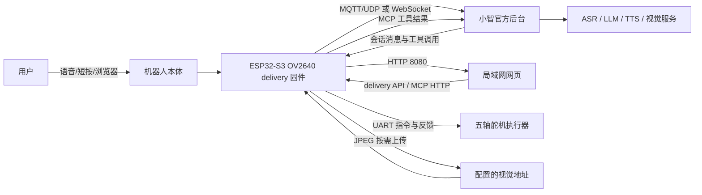

# OV2640 delivery 架构说明

本文以 `apple-lamp-ov2640-xiaozhi-delivery` 为当前交付基线，说明机器人本体、
ESP32 固件、小智后台和局域网测试页之间的职责边界与数据流。这里的“机器人”是
OV2640 摄像头台灯及其五轴执行机构，不包含另一个项目或云端服务中的未交付功能。

## 1. 交付边界

当前交付由以下部分组成：

- **机器人本体**：五轴灯臂/灯头、OV2640 DVP 摄像头、外接 PDM 麦克风、外接 I2S
  功放、ESP32-S3 主控和舵机 UART。
- **ESP32 固件**：负责配网、音频采集与播放、唤醒、会话协议、相机取帧、设备端 MCP、
  动作库、示教和局域网 8080 服务；源码中的跟书属于未完成实验功能，不是当前交付能力。
- **小智官方后台**：负责设备激活、会话编排、ASR/LLM/TTS 以及设备管理；角色设定
  和音色可在后台配置。每台台灯机器人作为独立设备管理，设备之间不会自动共享这些
  设置。固件默认通过 MQTT/UDP 或 WebSocket 传输，具体由构建配置选择；delivery
  不修改小智后端。
- **局域网网页**：操作者使用浏览器访问设备的 8080 测试页，完成标定、示教、动作
  库管理、JPEG 预览、跟书参数和诊断。网页不是后台，也不是设备的主动广播服务。
- **MCP**：云端会话使用设备注册的工具；网页使用 HTTP 包装的设备端 MCP 工具和
  delivery API。工具调用只是受理/查询入口，不能把受理状态当成机械到位。

下列路径不属于本文当前交付：

- `omni-poc` / `edge-runtime` 的阿里云百炼直连路径；
- `local-readonly`、`local-hardware`、`local-twin` 角色；
- 旧 OV3660 bring-up 的实机结论；
- 跟书功能及其低频视觉控制、自动搜书、身份识别、人脸注册或持续后台拍照。

## 2. 分层组织



### 2.1 机器人本体与板级资源

OV2640 板使用 ESP32-S3R8、16 MB Flash 和 8 MB Octal PSRAM：

| 子系统 | 当前连接/职责 |
| --- | --- |
| OV2640 | GPIO4/5 独立 SCCB；DVP GPIO6–18；XCLK 20 MHz；JPEG 按需取帧 |
| 功放 | GPIO38/39/40 的 I2S 输出，SD 接 3.3 V，软件不负责静音 |
| PDM 麦克风 | GPIO41/42；输入 16 kHz |
| 音频输出 | 24 kHz；PDM 单麦与外接功放不提供 AEC 回采，因此 AEC 关闭 |
| 舵机总线 | GPIO43 TX、GPIO44 RX；用于五轴状态反馈和动作执行 |
| BOOT | GPIO0；作为本地按键入口 |
| 持久化 | NVS 保存网络/标定及实验参数；LittleFS `lamp_actions` 保存用户动作 |

固件启动时保持运动未授权；卸力、使能、停止、限位和反馈新鲜度由执行器状态机
共同约束。delivery 分区将资源放在 `0x800000` 起的 7 MiB 区域，将动作库放在
`0xF00000` 起的 1 MiB 区域。首次迁移必须备份后烧录完整交付归档，不能只 OTA
应用并假设动作分区已经存在。

### 2.2 ESP32 固件内部

固件内部可按职责分为：

1. **Application/状态机**：协调启动、配网、激活、空闲、监听、说话、播放和网络事件；
   状态变化通过应用状态机完成，后台回调不直接阻塞主循环。
2. **Board/音频/相机**：提供板级 OV2640、PDM、I2S 和 UART 能力；上层依赖接口，
   不依赖具体 GPIO。
3. **Protocol**：封装 MQTT/UDP 或 WebSocket 的会话、音频和控制消息。传输变化不应
   改变设备工具和动作语义。
4. **McpServer**：注册通用工具和台灯工具，向小智会话暴露受控能力；用户专用工具
   与模型工具权限分离。
5. **Lamp delivery**：维护示教草稿、动作目录、LittleFS 原子写入、动作播放、有限的
   异步 job 历史，以及尚未完成的跟书实验状态/JPEG 缓存。
6. **Twin web**：提供同源、令牌保护的 8080 页面和 API；普通 HTTP 请求只读取状态
   或入队，不在 HTTP 回调中同步执行相机、Flash 或 UART 长操作。

## 3. 核心数据流

### 3.1 首次启动、配网与激活

1. 固件启动板级资源、音频服务、相机和网络配置；设备不会自动使能舵机。
2. 没有可用 Wi-Fi 时，设备启动 `Xiaozhi-*` SoftAP 和配置页。
3. 用户在手机上填入 Wi-Fi，ESP 保存网络配置并切换 STA。
4. 设备连接小智后台并进入激活状态，串口日志打印设备地址和激活提示。
5. 用户在小智官方控制台添加设备，并输入设备播报/显示的绑定验证码。
6. 激活完成后，设备建立会话，后续语音、工具和 OTA 均沿用官方设备身份。

### 3.2 语音会话

```text
麦克风
  -> ESP 音频服务 / 唤醒词 / VAD
  -> MQTT/UDP 或 WebSocket 音频上行
  -> 小智 ASR -> LLM 编排 -> TTS
  -> 音频下行
  -> ESP 解码/播放 -> 外接功放 -> 用户
```

会话中的控制消息和 MCP 工具调用通过同一个小智设备会话返回 ESP。音频优先于
后台动作：播放、说话或网络状态变化时，delivery 会暂停或拒绝会与音频冲突的
Flash/相机/机械操作。

### 3.3 MCP 与动作控制

模型只能调用固件在会话中注册的工具，不能提交任意舵机角度、轴值或 UART 帧。
delivery 角色的主要工具是：

| 工具 | 数据方向 | 作用 |
| --- | --- | --- |
| `self.lamp.list_user_actions` | ESP → 小智 | 返回动态用户动作目录和兼容性 |
| `self.lamp.play_user_actions` | 小智 → ESP | 按 ID 播放 1–16 个动作，返回本地 job |
| `self.lamp.get_delivery_state` | ESP → 小智 | 查询跟书、存储或 job 状态 |
| `self.lamp.start_book_tracking` | 小智 → ESP | 使用操作者确认的参数启动跟书，不自动上力 |
| `self.lamp.stop_book_tracking` | 小智 → ESP | 停止跟书并使旧视觉结果失效，保留支撑力矩 |

通用的设备状态、音量和相机能力仍由固件通用 MCP 按板级能力注册。交付动作必须
经过模式权限、安装绑定、反馈新鲜度、路径和物理限位检查；失败应拒绝或停止，
不能削幅后偷偷执行。

工具调用有两层完成概念：

- `job completed`：ESP 的动作库/跟书本地处理结束；
- `hardware task completed`：下游执行器反馈确认机械任务完成。

只有第二层才能说明机械到位；语音回复“好了”本身不是完成凭据。

### 3.4 示教、动作库与播放

```text
操作者 -> 8080 网页 teach_start
        -> ESP 停止跟书、卸力并确认
网页轮询 /api/lamp/state -> 读取五轴真实反馈
网页 capture -> 本地收集 2–32 帧
网页 save -> ESP 校验并保存相邻帧的弧度增量
网页/小智 list -> 动态目录发现
网页/小智 play -> ESP 预检 -> UART 执行器 -> 任务回执
```

动作文件使用临时文件、同步和原子替换；损坏文件标记为不可用，不自动格式化或
删除。播放从当前实际起点累加保存的相对增量，不先回到录制首帧。每条路径仍受
安装映射、设备限位、反馈、动作时长和队列容量约束。

### 3.5 跟书实验（不可交付）

```text
ESP 相机按周期取 JPEG
  -> 使用已配置的视觉 URL/Token 发起 HTTP 请求
  -> 接收 found/cx/cy/confidence
  -> 死区/比例增益/单步上限
  -> 仅产生 Yaw 与灯头 Pitch 微调
  -> 本地执行器预检 -> 舵机任务
```

视觉结果必须是可解析 JSON，或位于 `text`/`answer`/`content` 包装中；这套实验实现
仍未达到交付标准。格式不符、
置信度不足、连续三次请求失败、网络不可用或控制代际已变化时，不得驱动动作。
一请求在途，JPEG 不超过 64 KiB，响应正文不超过 8 KiB，结果 TTL 为 15 秒。
跟书是低频原型，不保证任意 Roll、极端姿态、高频伺服或自动找书。

## 4. 局域网 8080 数据面

ESP 是 HTTP 服务端，不做广播/组播；网页或 PC 主动轮询。首页返回临时令牌，
除首页外的 `/api/*` 请求需要 `X-Lamp-Token`，并校验 `Origin` 与 `Host`。

常用接口：

| 接口 | 用途 |
| --- | --- |
| `GET /api/lamp/state` | 执行器状态、五轴反馈、力矩和任务摘要 |
| `GET /api/lamp/delivery` | 动作目录、示教、存储和跟书状态 |
| `GET /api/lamp/delivery/jpeg` | 最新跟书 JPEG 预览 |
| `GET /api/lamp/delivery/jobs/<id>` | delivery 异步 job 回执 |
| `GET /api/lamp/tasks/<id>` | 硬件任务回执 |
| `GET /api/lamp/config` | 模型、关节、安装映射和限位配置 |
| `GET /api/lamp/history?after=<seq>` | 对话/工具历史 |
| `GET /api/mcp/tools` | 列出当前设备 MCP schema |
| `POST /api/mcp/call` | 以 JSON-RPC 风格调用设备 MCP 工具 |
| `POST /api/lamp/delivery` | 入队示教、保存、播放、跟书等操作 |

状态查询和命令受理是异步边界。客户端必须保存 `request_id`、`job_id` 和
`task_id`，轮询结果并处理 `unknown`、拒绝、超时和过期，不得因 HTTP 200 就宣称
动作完成。

## 5. 当前验证边界

当前源码、宿主测试和脚本已覆盖大量输入校验、动作增量、危险中段、图像格式、死区、
方向和示教保护；但文档不能替代以下实测：

- OV2640 图像颜色/镜像、云端视觉接口权限和持续调用额度；
- 连续跟书、断网/401/解析异常后的恢复；
- 文件系统断电写入和动作库迁移；
- 真实机械方向、反馈到位和两小时语音+网页+跟书稳定性。

这些结果应记录在开发实验记录中；跟书当前不可交付，不能因构建成功写成硬件验收通过。
